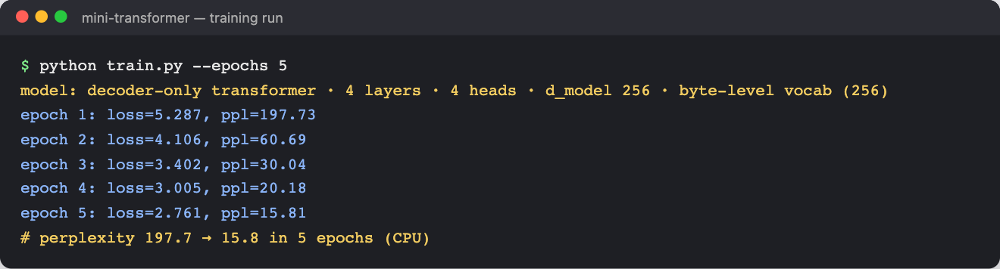

# mini-transformer — Decoder‑Only Transformer from Scratch 🧠⚡

A **from‑scratch implementation** of a tiny **decoder‑only Transformer** (GPT‑style) in PyTorch.
It trains on a toy corpus to learn next‑token prediction, with:
- Multi‑Head Self‑Attention + Causal Masking
- Position Embeddings & LayerNorm
- Feed‑Forward MLP
- Simple training loop with perplexity reporting

---

## Demo

A real training run on CPU (`python train.py --epochs 5`): the model learns the byte-level structure of the sample
text and perplexity falls from 197.7 to 15.8 in five epochs.



## 🚀 Features
- Pure‑PyTorch decoder‑only architecture (no Hugging Face required)
- Byte‑level tokenizer (works on any text)
- Causal masking for autoregressive training
- Configurable depth/heads/hidden size

## 🛠 Tech Stack
Python 3.9+, PyTorch, tqdm

## 📦 Install
```bash
pip install -r requirements.txt
```

## ▶️ Train
```bash
python train.py --epochs 3 --batch-size 32 --seq-len 128 --d-model 256 --n-heads 4 --n-layers 4
```

## 📁 Structure
```
mini-transformer/
│── train.py
│── data/toy.txt
│── requirements.txt
│── README.md
```

## 🔮 Upgrade Ideas
Rotary/ALiBi, Flash‑Attention, mixed precision, ONNX export.

## 📜 License
© 2025 Luqman Abdulwahab. Proprietary.
